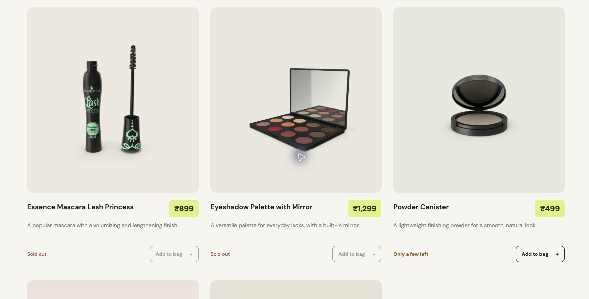
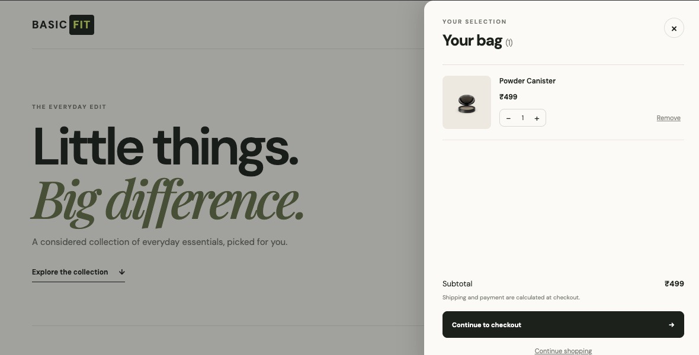
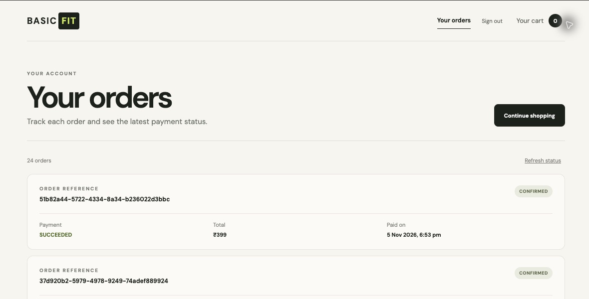

# Basic Ecommerce App

A single-repository D2C checkout take-home built with a React + TypeScript storefront, a Java 21 / Spring Boot API, and PostgreSQL. Docker Compose starts the frontend, API, and database together.

## Screenshots

These are real captures from the local demo UI. The demo database is persistent, so its current stock and order history reflect prior checkout activity; a fresh database starts with the five seeded products and original quantities.







## Run locally

### Requirements

- Docker Desktop with Docker Compose
- Stripe CLI only if you want to complete an end-to-end payment

### Start the app

From the repository root:

```sh
curl --fail --location --show-error \
  'https://drive.google.com/uc?export=download&id=19ZVjFdEJiMQ_qzhz-7LuajjRqIBoo78Y' \
  --output .env
chmod 600 .env
docker compose up --build
```

The first command downloads the shared environment file from Google Drive directly into the local `.env` file. If you are not using the shared file, copy `.env.example` to `.env` and fill in the values you need.

Open <http://localhost:8080>. Nginx serves the frontend and proxies `/api/*` and `/webhooks/*` to Spring Boot. The API listens on port `8080` inside the Compose network; PostgreSQL is also internal to Compose. Check the API at <http://localhost:8080/api/health>.

Stop the services with:

```sh
docker compose down
```

PostgreSQL data lives in the named `postgres_data` volume and survives container rebuilds and `docker compose down`. `docker compose down -v` deletes that local database, including orders and stock changes. Flyway applies schema migrations and seeds the demo account and catalog on the first database startup.

The repository's `.env.example` contains local development defaults. The downloaded `.env` may include payment credentials; keep it local and never commit it. Do not put Stripe keys in frontend variables.

### Enable Stripe test checkout

1. The downloaded `.env` includes the provided Stripe test-mode secret key; leave that value in place.
2. Start the Stripe CLI listener in a second terminal:

   ```sh
   stripe listen \
     --events checkout.session.completed,checkout.session.async_payment_succeeded,checkout.session.async_payment_failed,checkout.session.expired \
     --forward-to localhost:8080/webhooks/stripe
   ```

3. Copy the listener's `whsec_...` value to `STRIPE_WEBHOOK_SECRET` in `.env`, then restart the API:

   ```sh
   docker compose up -d --build backend
   ```

4. Sign in, add an available product, and continue through Stripe Checkout. For a successful test payment, use `4242 4242 4242 4242`, any future expiry date, and any CVC.

## What is implemented

### Catalog and cart

- Five fixed product records are seeded by Flyway in `V1__create_products.sql`; DummyJSON image URLs are stored as product data, and the app does not call DummyJSON at runtime.
- `GET /api/products` returns active products, INR prices in paise, image URL arrays, and available stock. The UI shows “Only a few left” for low stock and “Sold out” at zero, without displaying the inventory count.
- Product cards support image carousels. A guest can add, remove, and change quantities in a browser-local cart; the cart survives sign-in in that browser. A full account-synced cart is outside this first pass.

### Authentication and checkout

- Checkout requires a signed-in user. The UI offers signup, email/password login, and a migration-seeded demo login; Google and Apple options are visibly disabled.
- Use the demo account `demo@basicfit.local` / `demo12345`. Demo credentials are for this local app only.
- Session tokens are opaque bearer tokens with a 12-hour expiry. The browser stores the current token in local storage; PostgreSQL stores only its SHA-256 hash. Private `/api/**` routes validate the bearer token and scope order history to the signed-in user.
- `POST /api/checkout` accepts product IDs and quantities, plus an `Idempotency-Key` header. The server reloads product prices and calculates totals; it does not trust client-supplied prices.
- Checkout validates products and quantities, reserves inventory, and writes the order, item snapshots, payment record, and idempotency mapping in one PostgreSQL transaction. A retry with the same key and same cart returns the original result; reusing that key with a different cart returns `409 Conflict`.

### Orders and payment state

- The signed-in “Your orders” page reads only that user's orders from `GET /api/orders` and shows order state, payment state, total, and payment date when the payment succeeds.
- Current payment implementation: Stripe-hosted Checkout in **test mode**. `POST /api/payments/{paymentId}/stripe-session` creates or reuses the Checkout Session.
- Current webhook route: **`POST /webhooks/stripe`**. It receives the raw body and `Stripe-Signature` header, verifies the signature with Stripe's SDK, checks the event's payment/order reference/amount/currency, and records event IDs to make replays idempotent. Successful events confirm the order; failed or expired sessions mark the payment/order and release reserved stock.
- The success return page makes one explicit `POST /api/orders/by-reference/{referenceId}/reconcile` request to Stripe if webhook delivery has not updated the order yet. It does not poll continuously. Order lookup and reconciliation are owner-scoped.

### Assignment deviation: payment provider

The take-home asks for a **mocked payment provider** and `POST /webhooks/payment`. This first pass uses Stripe test-mode Checkout and exposes `POST /webhooks/stripe` instead. The raw-body signature check, replay deduplication, order/payment state transitions, and stock release are implemented, but the provider and endpoint do not match that requested mock contract. Replace Stripe with a deterministic mock provider and add the specified route before claiming strict payment-provider compliance.

## API quick reference

| Method and path | Access | Purpose |
| --- | --- | --- |
| `GET /api/products` | Public | Read the seeded catalog |
| `POST /api/auth/signup` | Public | Create an account and session |
| `POST /api/auth/login` | Public | Sign in with email/password |
| `POST /api/auth/demo` | Public | Start a session for the seeded demo user |
| `POST /api/checkout` | Bearer token | Validate cart, reserve stock, persist order/payment |
| `POST /api/payments/{paymentId}/stripe-session` | Bearer token | Create or reuse Stripe Checkout Session |
| `GET /api/orders` | Bearer token | List only the current user's orders |
| `GET /api/orders/by-reference/{referenceId}` | Bearer token | Read an owned order's status |
| `POST /api/orders/by-reference/{referenceId}/reconcile` | Bearer token | Explicitly reconcile a returned Stripe payment |
| `POST /webhooks/stripe` | Stripe signature | Verify and apply Stripe Checkout events |

## Assumptions

- The catalog is a fixed five-SKU sample. Product names, descriptions, INR prices, and image URLs are seeded locally; there is no catalog administration or live upstream catalog dependency.
- Checkout uses INR, with monetary values stored as integer paise. Shipping, tax, addresses, discounts, refunds, and fulfillment are outside the requested slice.
- Guest carts belong to one browser's local storage. Sign-in does not merge a remote/server cart because there is no server-side cart in this version.
- Inventory is reserved at checkout and becomes available again after a failed or expired payment. The order is confirmed only after a verified successful provider event or a successful Stripe reconciliation.
- OAuth buttons are placeholders, while email/password signup, login, and the seeded demo login are working local flows.

## Design decisions

| Decision and trade-off | Rejected alternative |
| --- | --- |
| **Java 21 + Spring Boot with React/TypeScript.** This matches the implementation owner's Java experience and keeps the backend in MVC layers. It takes more setup than a small Node service, but gives a clear controller/service/repository boundary. | A single Node.js application would reduce language/tooling variety, but would move the backend away from the chosen Java stack. |
| **PostgreSQL with Flyway and transactional stock reservation.** Relational constraints and one transaction keep stock, order, payment, and idempotency records consistent. Migrations and local volume state add setup and can require deliberate reset/repair during iteration. | In-memory or JSON-file persistence would start faster, but would lose durable order history and safe concurrent stock updates. |
| **Stripe test mode for the first payment pass.** It exercises a real hosted checkout redirect and signed webhook lifecycle, but depends on test credentials and diverges from the requested mock provider/route. | A deterministic mock provider would make the assignment simpler to run and exactly match its contract; it remains the first payment change planned below. |

### Handled failure case: stock runs out during checkout

If another checkout consumes an item after the catalog was displayed, the conditional stock update affects zero rows. `CheckoutService` raises `OUT_OF_STOCK` and the enclosing transaction rolls back earlier reservations and checkout writes, so the cart cannot create a partially reserved order. See [`CheckoutService.java`](backend/src/main/java/com/basic_ecommerce/app/service/CheckoutService.java#L60-L118) and the conditional update in [`OrderProductStockRepository.java`](backend/src/main/java/com/basic_ecommerce/app/repository/OrderProductStockRepository.java#L11-L20).

Webhook input is separately rejected when its signature is missing or invalid; the endpoint keeps the raw body for Stripe signature verification in [`PaymentWebhookController.java`](backend/src/main/java/com/basic_ecommerce/app/controller/PaymentWebhookController.java#L25-L44) and [`StripeWebhookService.java`](backend/src/main/java/com/basic_ecommerce/app/service/StripeWebhookService.java#L58-L103).

## What I would change after the first pass

Before final submission, I would put payment behind a small provider interface, make the mock provider the default, and implement the exact `POST /webhooks/payment` contract from the assignment. I would keep Stripe as an optional adapter only if it can be cleanly isolated. I would also replace the browser-only guest cart with an account-scoped cart if the expected experience needs cross-device continuity.

## Week-two plan

1. Complete the mock-payment adapter and assignment webhook route; document its test event format and replay behavior.
2. Expand JUnit and integration coverage for cart validation, same-key retries, key reuse with a different cart, concurrent stock reservation, payment success/failure/expiry, invalid signatures, duplicate events, and per-user order visibility.
3. Exercise the full flow from a clean database and from a persisted database, including failed-payment retry and cart restoration behavior.
4. Add CI for the backend and frontend builds, then prepare a short demo walkthrough showing catalog, cart, checkout, webhook transition, and order history.

## Project layout

- `frontend/`: React, TypeScript, Vite components, and Nginx configuration.
- `backend/`: Java 21, Spring Boot MVC controllers/services/repositories, JPA, and Flyway migrations.
- `docker-compose.yml`: frontend, backend, and PostgreSQL services in one local Compose application.
- `docs/screenshots/`: local UI screenshots embedded above.
